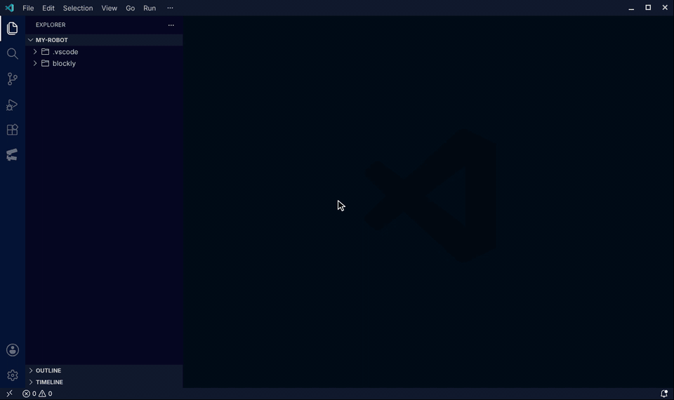
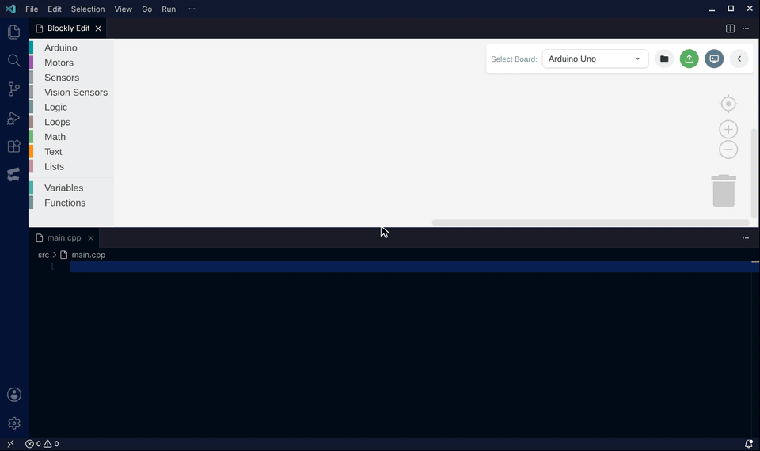
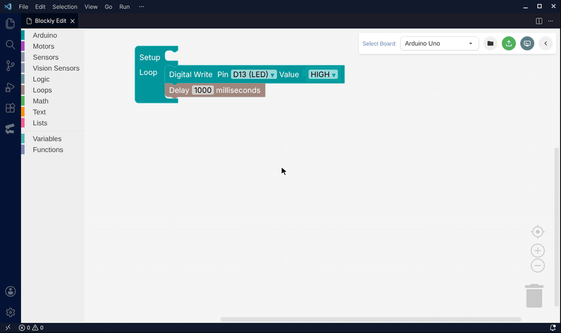

# Singular Blockly

[English](../../README.md) · [繁體中文](README.zh-hant.md) · [日本語](README.ja.md) · [한국어](README.ko.md) · [Deutsch](README.de.md) · [Español](README.es.md) · [Français](README.fr.md) · **Italiano** · [Polski](README.pl.md) · [Português (Brasil)](README.pt-br.md) · [Русский](README.ru.md) · [Türkçe](README.tr.md) · [Čeština](README.cs.md) · [Magyar](README.hu.md) · [Български](README.bg.md)

> Questo documento è una traduzione del [README](../../README.md) in inglese. In caso di differenze, fa fede la versione inglese.

<p align="center">
  
</p>

**Programmazione visuale per Arduino, CyberBrick e fischertechnik TXT Controller, direttamente in VS Code.**

Crea programmi con Blockly, guarda subito il codice generato e caricalo tramite PlatformIO, USB, OTA sulla rete locale o SSH.

[Installa da VS Code Marketplace](https://marketplace.visualstudio.com/items?itemName=Singular-Ray.singular-blockly) · [Installa da Open VSX](https://open-vsx.org/extension/Singular-Ray/singular-blockly) · [Leggi la documentazione](../specifications/README.md)

## Guardalo in azione

Queste registrazioni sono state fatte in una vera finestra di VS Code con la build attuale dell’estensione.

**1. Apri l’editor e scegli una scheda.** Fai clic sull’icona di Singular Blockly nella barra delle attività, poi scegli la tua scheda in «Seleziona scheda».



**2. Trascina i blocchi e guarda il codice aggiornarsi.** Trascina i blocchi dalla casella degli strumenti in «Configurazione» e «Loop», cambia i valori con i menu a tendina e tieni `src/main.cpp` aperto accanto all’editor per vedere il programma generato cambiare mentre lavori.



**3. Cambia lingua e tema.** Espandi la barra degli strumenti con il pulsante a freccia, usa il menu del globo per cambiare subito la lingua dell’editor e usa il pulsante del tema per passare da chiaro a scuro.



## Feedback, servizi online e uso dei dati

Usa il pulsante «Invia un feedback» nell’editor Blockly, esegui **Singular Blockly: Invia un feedback** dal riquadro comandi oppure usa lo strumento di segnalazione problemi di VS Code. Non serve un account GitHub. Aprire o compilare il modulo non effettua richieste di rete; prima dell’invio il modulo mostra tutto il contenuto e chiede una conferma esplicita.

La diagnostica di base dell’ambiente è attiva per impostazione predefinita e si può disattivare. Gli eventi strutturati recenti sono disattivati per impostazione predefinita. L’elenco dei campi consentiti esclude codice sorgente, contenuto dell’area di lavoro Blockly, codice generato, nomi di file e cartelle, percorsi, identificativi di computer e dispositivi, porte seriali, informazioni Wi-Fi e IP, variabili d’ambiente, credenziali, errori e log grezzi. Uno screenshot facoltativo viene ricodificato in locale, privato dei metadati originali, limitato a 1920 pixel e 3 MiB, mostrato in anteprima e inviato solo dopo la conferma.

Il feedback usa un segreto anonimo salvato in VS Code SecretStorage e un servizio Cloudflare D1/R2 dedicato; i manutentori lavorano con un repository GitHub privato. Questo invio di assistenza avviato dall’utente non è telemetria né analisi. Consulta l’[informativa sulla privacy](../../PRIVACY.md), la [politica di assistenza](../../SUPPORT.md), i [termini del servizio di feedback](../../TERMS.md) e la [politica di sicurezza](../../SECURITY.md).

## Perché Singular Blockly?

- **Un editor visuale, tre flussi di programmazione**: Arduino C++, CyberBrick MicroPython e TXT Controller Python.
- **Caricamento diretto sull’hardware**: PlatformIO per Arduino, USB o OTA su LAN abbinata per CyberBrick e SSH per TXT Controller.
- **Strumenti pensati per la classe**: esempi localizzati, controlli virtuali TXT, test di I/O, backup e diagnostica hardware chiara.
- **Un’esperienza Blockly moderna**: Blockly 13.4.0 con `@blockly/theme-modern`, temi chiaro e scuro, ricerca dei blocchi, supporto touch, navigazione da tastiera ed etichette dei controlli descrittive, tutto incluso per l’uso offline.
- **File di progetto sicuri**: salvataggio automatico, ripristino dai backup, protezione dai blocchi orfani e convalida in tempo reale delle modifiche esterne all’area di lavoro.
- **Progetti pronti per l’IA**: gli Agent Skills locali al progetto forniscono agli agenti di programmazione la scheda attuale, il formato dell’area di lavoro e il contratto dei blocchi.

## Avvio rapido

1. Installa Singular Blockly da [VS Code Marketplace](https://marketplace.visualstudio.com/items?itemName=Singular-Ray.singular-blockly) o [Open VSX](https://open-vsx.org/extension/Singular-Ray/singular-blockly).
2. Apri in VS Code una cartella scrivibile.
3. Fai clic sull’icona di Singular Blockly nella barra delle attività oppure esegui **Singular Blockly: Apri editor Blockly** dal riquadro comandi.
4. Seleziona una scheda e costruisci il programma dalla casella degli strumenti.
5. Apri il file generato (per esempio `src/main.cpp`) per controllare il codice, poi fai clic sul pulsante di caricamento nella barra degli strumenti dell’editor.

All’avvio di VS Code, Singular Blockly inizia a preparare nello spazio di archiviazione dell’estensione un Python verificato, PlatformIO Core nell’intervallo di versioni testato e l’ambiente `mpremote`. All’apertura dell’editor Blockly l’ambiente viene ricontrollato senza bloccare la modifica. Per Arduino resta prioritario il provider: VS Code usa `platformio.platformio-ide`, mentre gli ambienti Open VSX come VSCodium possono usare `pioarduino.pioarduino-ide`; il Singular Core è la soluzione di riserva. Una cartella personalizzata per l’ambiente gestito deve essere vuota al primo utilizzo, così riparazione e pulizia non adottano file estranei.

<details>
<summary><b>Installazione offline del VSIX</b></summary>

1. Scarica l’ultimo `.vsix` da [GitHub Releases](https://github.com/Shen-Ming-Hong/singular-blockly/releases).
2. Apri **Extensions: Install from VSIX...** (Estensioni: Installa da VSIX) dal riquadro comandi.
3. Seleziona il file scaricato.

```bash
code --install-extension singular-blockly-X.Y.Z.vsix
```

</details>

<details>
<summary><b>Risoluzione dei problemi di CyberBrick via USB</b></summary>

`mpremote` viene installato automaticamente nell’ambiente gestito di Singular, che non richiede un Python di sistema. Apri la **diagnostica PlatformIO** per controllarlo o ripararlo. L’ambiente del provider PlatformIO resta come riserva di compatibilità e Singular Blockly non lo rimuove né lo pulisce mai.

</details>

## Schede supportate

| Scheda                        | Codice generato  | ID selettore | Caricamento / esecuzione                                  |
| ----------------------------- | ---------------- | ------------ | --------------------------------------------------------- |
| Arduino Uno                   | `src/main.cpp`   | `uno`        | PlatformIO                                                |
| Arduino Nano                  | `src/main.cpp`   | `nano`       | PlatformIO                                                |
| Arduino Mega                  | `src/main.cpp`   | `mega`       | PlatformIO                                                |
| ESP32 Dev Module              | `src/main.cpp`   | `esp32`      | PlatformIO                                                |
| ESP32-C3 Super Mini           | `src/main.cpp`   | `supermini`  | PlatformIO                                                |
| CyberBrick                    | `src/rc_main.py` | `cyberbrick` | USB `mpremote` o OTA su LAN abbinata → `/app/rc_main.py`  |
| fischertechnik TXT Controller | `src/main.py`    | `txt`        | SSH + `python3` → `/tmp/singular_blockly/main.py`         |

I progetti Arduino mantengono `platformio.ini`; i progetti CyberBrick e TXT usano flussi Python e lo rimuovono quando non serve.

## Flussi principali

### Arduino ed ESP32

- Genera C++ per Arduino e sincronizza `platformio.ini` automaticamente.
- Compila e carica con PlatformIO, con rilevamento delle porte in base alla scheda e messaggi di errore che indicano cosa fare.
- Mostra l’output seriale in un terminale di VS Code; nei progetti ESP32 la decodifica delle eccezioni si attiva automaticamente.
- Offre blocchi per I/O, PWM, servo, motore con encoder, Wi-Fi/MQTT, Pixetto, HUSKYLENS e programmazione standard.
- Riceve su un ESP32 DevKit i comandi del telecomando CyberBrick via ESP-NOW con i blocchi sperimentali del ricevitore RC.

### CyberBrick

- Genera MicroPython per l’ESP32-C3, con blocchi per GPIO, LED integrato, temporizzazione, Wi-Fi, X11/X12 e telecomando ESP-NOW.
- Usa l’USB per impostazione predefinita; una destinazione OTA abbinata sulla rete locale si configura dal menu a ingranaggio di CyberBrick.
- La prima configurazione OTA si completa via USB. Un caricamento OTA non riuscito non passa mai automaticamente all’USB, così il codice non finisce sul dispositivo sbagliato in classe.
- Mantiene aggiornati gli agenti OTA compatibili durante i caricamenti in rete; un avviso di aggiornamento dell’agente non annulla il caricamento del programma principale.
- Mostra l’output `print()` di MicroPython tramite `mpremote` in un terminale di VS Code.
- Permette di sfogliare esempi CyberBrick localizzati, con esempi inclusi per l’uso offline.
- Conserva password Wi-Fi, token OTA e segreti di abbinamento in VS Code SecretStorage. La configurazione OTA non modifica firmware, `/boot.py`, WebREPL o altri file del dispositivo.

[Dettagli su CyberBrick](../specifications/03-hardware-support/cyberbrick-micropython.md) · [Schede di espansione](../specifications/03-hardware-support/cyberbrick-expansion-boards.md) · [Abbinamento RC](../specifications/03-hardware-support/cyberbrick-rc.md)

### TXT Controller

- Crea un flusso di configurazione e più flussi di processo TXT eseguiti in parallelo.
- Carica, esegui e ferma programmi Python via SSH.
- Configura e verifica la connessione senza lasciare l’editor Blockly.
- Crea pulsanti virtuali trascinabili con associazioni stabili.
- Prova motori, uscite e sensori dal pannello integrato di test I/O.

Le password del TXT sono salvate in VS Code SecretStorage. La destinazione predefinita è `192.168.7.2` con l’utente `ftc`; il programma generato viene caricato in `/tmp/singular_blockly/main.py`.

[Dettagli su TXT Controller](../specifications/03-hardware-support/txt-controller.md)

### Flussi assistiti dall’IA

Gli Agent Skills locali al progetto forniscono a Codex e Claude Code la scheda attuale, il formato dell’area di lavoro e il contratto dei blocchi derivato in fase di esecuzione. Non serve installare un server Node.js.

Le modifiche esterne a `blockly/main.json` passano da ambienti Blockly usa e getta prima di raggiungere l’area di lavoro attiva. I contenuti non validi vengono messi in quarantena e viene ripristinata l’ultima area di lavoro valida.

[Agent Skills e sicurezza dell’area di lavoro](../specifications/06-features/agent-skills.md)

## File del progetto

| Percorso                | Scopo                                                              |
| ----------------------- | ------------------------------------------------------------------ |
| `blockly/main.json`     | Fonte di riferimento per blocchi, scelta della scheda e stato dell’interfaccia |
| `blockly/main.json.bak` | Backup dell’ultima area di lavoro valida                           |
| `src/main.cpp`          | Programma Arduino / ESP32 generato                                 |
| `src/rc_main.py`        | Programma MicroPython CyberBrick generato                          |
| `src/main.py`           | Programma TXT Controller generato                                  |
| `platformio.ini`        | Configurazione dell’ambiente PlatformIO, solo per Arduino          |

## Configurazione

Le impostazioni sono disponibili nell’interfaccia Impostazioni di VS Code. I valori predefiniti qui sotto corrispondono al manifesto dell’estensione.

| Impostazione                                  | Predefinito                                   | Scopo                                                     |
| --------------------------------------------- | --------------------------------------------- | --------------------------------------------------------- |
| `singularBlockly.managedRuntime.path`         | `""`                                          | Cartella facoltativa per l’ambiente gestito               |
| `singularBlockly.safetyGuard.suppressWarning` | `false`                                       | Nascondere l’avviso di sicurezza per progetti non Blockly |
| `singular-blockly.txt.host`                   | `192.168.7.2`                                 | Host del TXT Controller                                   |
| `singular-blockly.txt.username`               | `ftc`                                         | Nome utente SSH del TXT                                   |
| `singular-blockly.txt.remotePath`             | `/tmp/singular_blockly/main.py`               | Destinazione del caricamento sul TXT                      |
| `singular-blockly.txt.runtimePort`            | `8080`                                        | Porta di base del pannello di test I/O del TXT            |
| `singular-blockly.cyberbrick.uploadSettings`  | `{ "schemaVersion": 2, "pairedDevices": [] }` | Registro dei dispositivi CyberBrick USB / OTA abbinati    |

Password Wi-Fi, token OTA, segreti di abbinamento e password del TXT sono salvati in VS Code SecretStorage, non in `settings.json`. Documentazione e log usano segnaposto o valori oscurati; non incollare mai credenziali reali nei file di progetto o nelle segnalazioni di bug.

## Requisiti

- VS Code 1.126.0 o successivo, oppure VSCodium 1.126.04524 o successivo. Aggiorna gli editor più vecchi prima di installare questa versione.
- Una cartella dell’area di lavoro con permessi di scrittura.
- Arduino / ESP32: un provider PlatformIO e l’estensione C/C++ (`ms-vscode.cpptools`).
- CyberBrick: USB per il caricamento normale e la prima configurazione OTA; una rete locale condivisa solo per l’OTA. Dopo l’attivazione, l’estensione prepara `mpremote` nel proprio ambiente Python gestito e lo ricontrolla all’apertura dell’editor Blockly.
- TXT Controller: accesso di rete al controller, con Python 3 e `ftrobopy` disponibili sul dispositivo.

Chi usa l’estensione non ha bisogno di Node.js.

## Documentazione e aiuto

L’interfaccia è disponibile in 15 lingue: inglese, cinese tradizionale, giapponese, coreano, tedesco, spagnolo, francese, italiano, polacco, portoghese (Brasile), russo, turco, ceco, ungherese e bulgaro. La modalità automatica segue la lingua di visualizzazione di VS Code, e il menu del globo dell’editor permette di cambiare lingua all’istante. Questo README è disponibile nelle stesse 15 lingue; usa i collegamenti alle lingue in cima alla pagina.

- [Specifiche integrate](../specifications/README.md)
- [Diagnostica PlatformIO e riparazione guidata](../specifications/06-features/platformio-diagnostics.md)
- [Monitor seriale](../specifications/06-features/serial-monitor.md)
- [Internazionalizzazione](../specifications/02-internationalization/i18n.md)
- [Flusso di localizzazione dell’interfaccia](../specifications/02-internationalization/user-facing-localization.md)
- [Registro delle modifiche](../../CHANGELOG.md)
- [Segnalazione problemi](https://github.com/Shen-Ming-Hong/singular-blockly/issues)
- [Politica di sicurezza](../../SECURITY.md)

Progetto di esempio: [CyberBrick SoccerBot](https://github.com/Shen-Ming-Hong/Blockly_SoccerBot), un robot telecomandato via ESP-NOW con documentazione in inglese e cinese tradizionale.

## Sviluppo

I comandi di sviluppo e compilazione sono nella sezione Development del [README](../../README.md#development) in inglese e in [CONTRIBUTING.md](../../CONTRIBUTING.md).

## Licenza

Distribuito con licenza [Apache License 2.0](../../LICENSE).
